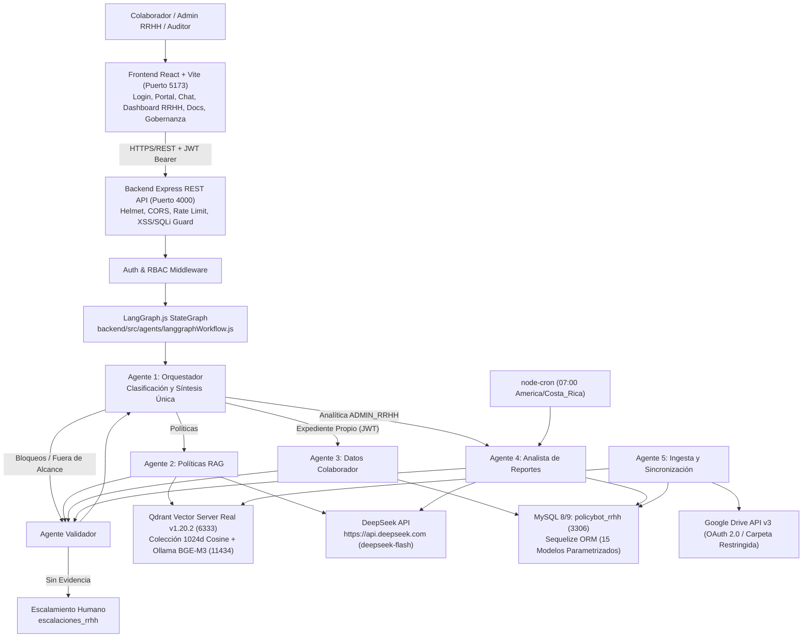

# Arquitectura del Sistema — PolicyBot HR

## Visión General
PolicyBot HR implementa una arquitectura modular desacoplada en tres capas principales (Frontend React, Backend REST + Multiagente LangGraph.js, y Capa de Datos Híbrida MySQL + Qdrant/Ollama), gobernada por controles estrictos de privacidad (Ley N° 8968) y supervisión humana.

## Diagrama de Arquitectura

## Infraestructura Vectorial y Almacenamiento
- **Servidor Qdrant Real (v1.20.2):** Se ejecuta en el host local en `http://127.0.0.1:6333` (REST) y puerto `6334` (gRPC). También se incluye la receta reproducible en `docker-compose.yml` (`qdrant/qdrant:v1.20.2` con volumen persistente `qdrant_storage`).
- **Colección Vectorial:** `policybot_hr_docs` configurada con tamaño de vector `1024`, métrica de distancia `Cosine` y modelo `bge-m3:latest`.
- **Idempotencia y Sin Duplicados:** Cada fragmento se mapea a un UUID v4 determinista mediante RFC 4122 v4 derivado del `chunk_id`, impidiendo duplicaciones en reindexaciones continuas.
- **Desactivación de Fallback Silencioso:** `RAG_ALLOW_LOCAL_VECTOR_FALLBACK=false` asegura que en entornos de producción y auditoría formal todas las operaciones vectoriales consulten estrictamente el servidor Qdrant real.

## Flujo de Seguridad y Trazabilidad
1. **Autenticación:** El cliente envía credenciales a `POST /api/auth/login`; el backend verifica el hash `bcrypt` y firma un JWT con `usuarioId`, `colaboradorId`, `rol` y `permisos`.
2. **Aislamiento de Identidad:** Ni `GET /api/employee/me` ni `POST /api/chat/query` aceptan un `colaboradorId` proveniente del cuerpo o query de otro usuario; toda consulta personal se resuelve desde `req.user.colaboradorId`.
3. **Auditoría:** Todo acceso denegado (401/403), bloqueo de prompt injection, consulta RAG o generación de reporte queda registrado en `audit_logs`.
